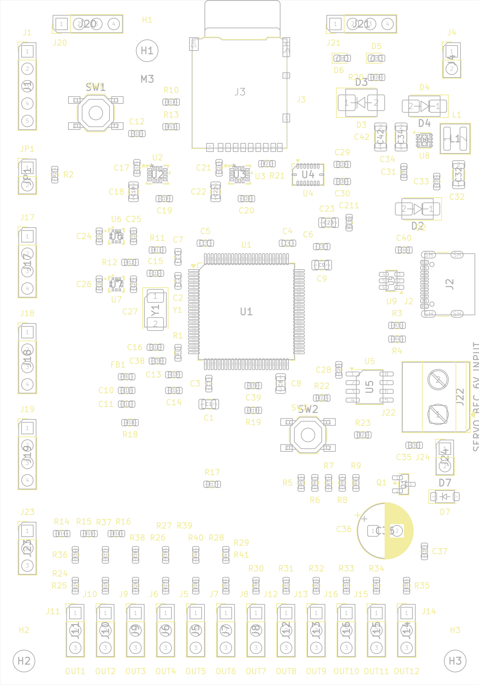

# STM32H743 VTOL Flight Controller

Custom four-layer flight-controller hardware for VTOL and fixed-wing aircraft, designed in **KiCad 10** around the **STM32H743VITx**. The intended aircraft configuration is four lift motors, one cruise motor and up to five servos. The hardware has twelve output connectors, allowing spare channels.

**Status: routed hardware prototype.** PX4 integration is planned; this repository does not contain a completed PX4 board port, bootloader or flight-tested firmware. The board has not been electrically or flight qualified. Design-rule checks do not establish functional or flight safety.

[Hardware inspection guide](docs/PROJECT-RU.md) · [Board review and bring-up checklist](docs/PROJECT-RU.md#before-fabrication-and-bring-up)

## Hardware

- STM32H743VITx microcontroller, external 8 MHz crystal, SWD and reset/boot access.
- Two ICM-42688-P inertial sensors and one BMI088; BMP390 barometers.
- SPI FRAM and a microSD socket using SDMMC.
- USB-C USB 2.0 device interface with separate CC pull-down resistors and USB protection.
- GPS, telemetry and RC UART connectors; external I2C connectors for compass/airspeed devices.
- Battery-voltage and external current-sense inputs, status indicators, safety input and buzzer circuitry.
- Twelve signal/GND output headers; OUT7–OUT12 also carry a separately supplied servo rail.
- TPS62162DSG fixed 3.3 V buck regulator and a filtered analog supply.
- Approximate board size: 70 × 100 mm; four copper layers; nominal thickness 1.6 mm.

Exact component references, values, connections and footprints are defined by the KiCad sources. The BOM CSV files cover footprint assignments and selected power/crystal/decoupling parts; they are not a fully qualified purchasing BOM.

## Open the project

1. Download the repository or clone it with `git clone https://github.com/ukinori/flightcontroller.git`.
2. Open **flightcontroller.kicad_pro** in KiCad 10.
3. Open **flightcontroller.kicad_sch** for the schematic hierarchy and **flightcontroller.kicad_pcb** for the routed board.
4. Install the standard KiCad symbol and footprint libraries. Project-specific libraries are bundled in **FlightController.kicad_sym** and **FlightController.pretty/** and use `${KIPRJMOD}` paths.
5. Refill copper zones and rerun ERC/DRC after making changes.

The root schematic contains MCU, power and interface sheets. The MCU sheet is currently named **untitled.kicad_sch**; this file is required by the hierarchy.

## Power connections

- **J4:** regulated **5 V input** for the controller; pin 1 is +5V and pin 2 is GND.
- The intended 6–12S aircraft battery requires a **separate external regulator**. Do not connect raw pack voltage to J4.
- USB VBUS and the external supply feed the controller input through diode paths; the onboard converter produces 3.3 V.
- **J22:** separate regulated **6 V servo supply**; pin 1 is VCC_SERVO and pin 2 is GND. The connector footprint is Phoenix Contact **1715721**.
- Controller and servo grounds are common. Servo power is independent of the 3.3 V logic supply.

The servo distribution has a provisional 10 A aggregate design target, **not a verified current rating**. Select actual servos, calculate combined stall/peak current and validate the BEC, connector, wiring, copper thickness, voltage drop and temperature rise before use. Servos/ESCs must accept the controller's signal levels.

## Output mapping

Every output header uses pin 1 for signal and pin 3 for GND. Pin 2 is unconnected on OUT1–OUT6; on OUT7–OUT12 it is VCC_SERVO.

- OUT1 — J11 — PE9, through R31.
- OUT2 — J10 — PE11, through R33.
- OUT3 — J9 — PE13, through R30.
- OUT4 — J6 — PE14, through R27.
- OUT5 — J5 — PC6, through R26.
- OUT6 — J7 — PC7, through R35.
- OUT7 — J8 — PD12, through R32.
- OUT8 — J12 — PD13, through R28.
- OUT9 — J13 — PD14, through R34.
- OUT10 — J16 — PD15, through R25.
- OUT11 — J15 — PA0, through R29.
- OUT12 — J14 — PA1, through R24.

The intended allocation is OUT1–OUT5 for five DShot ESCs, OUT7–OUT11 for five PWM servos, and OUT6/OUT12 as spares. Timer, DMA and output-mode support still need implementation and testing in a dedicated PX4 board port.

## Other connectors

- **J1 SWD:** pin 1 SWDIO, pin 2 SWCLK, pin 3 NRST, pin 4 3.3 V reference, pin 5 GND.
- **J18 GPS:** pin 1 +5V, pin 2 controller TX, pin 3 controller RX, pin 4 GND.
- **J19 telemetry:** pin 1 +5V, pin 2 controller TX, pin 3 controller RX, pin 4 GND.
- **J17 RC UART:** pin 1 +5V, pin 2 controller TX, pin 3 controller RX, pin 4 GND.
- **J20/J21 external I2C:** pin 1 +3.3V, pin 2 SCL, pin 3 SDA, pin 4 GND.
- **J23 sensing:** pin 1 battery-voltage sensing input, pin 2 external 0–3.3 V current-sense signal, pin 3 GND. Confirm the divider range against the actual battery and component ratings before connecting it.

TX/RX names refer to the controller. Check the external device's voltage levels and cable pinout; matching connector size does not establish compatibility.

## Copper layers

- **F.Cu:** components and signal/power tracks, GND pours and servo-power copper.
- **In1.Cu:** GND plane, without ordinary routed tracks.
- **In2.Cu:** 3.3 V pour plus signal and power routing. It is not an uninterrupted power plane.
- **B.Cu:** signal/power routing plus +5V and VCC_SERVO pours.

Review the final manufacturer's stack-up, signal return paths, USB/SDMMC routing, converter layout and servo-current distribution before fabrication. Current design minima include 0.15 mm tracks/clearances and 0.20 mm via drills; these require manufacturer confirmation.

## Verification snapshot — 2026-10-21

KiCad CLI 10.0.4 checks on the publication snapshot:

- ERC: **0 reported violations**.
- DRC: **0 reported physical violations**.
- Unconnected items: **0**.
- Schematic/PCB parity issues: **0**.

The existing project settings ignore some checks. DRC ignores `missing_courtyard`, `track_not_centered_on_via`, `tuning_profile_track_geometries`, `footprint_filters_mismatch` and `footprint_type_mismatch`. ERC ignores `single_global_label`, `four_way_junction`, `simulation_model_issue` and `footprint_filter`. The JSON reports retain this information. Zero findings apply to this configured check set.

Current reports are in **verification/**. Older reports and routing notes in the root directory are retained as historical records; the three U8/L1 parity warnings described in the older notes were not reproduced in the 2026-10-21 snapshot.

## Repository contents

- Root KiCad files — flight-controller schematic, PCB and project settings.
- `FlightController.pretty/`, `FlightController.kicad_sym` — project-local CAD libraries.
- CSV/Markdown files — component-selection records, footprint assignments and engineering notes.
- `verification/` — fresh ERC and DRC reports for this publication snapshot.
- `docs/PROJECT-RU.md` — English hardware inspection and bring-up guide. Legacy filenames containing `RU` are retained for existing links; all current documentation is in English.
- `meshtransciever/` — a separate, unfinished radio/mesh hardware project included from the source folder. Its PCB is a placeholder; it is not part of the flight-controller verification results.

Editor history, restore backups, lock files and machine-specific UI state are excluded. The publication copy replaces the root machine-specific symbol-library table with a project-relative table; the working CAD source folder is unchanged.

## Remaining work

1. Complete schematic, layout, power-budget, thermal, mechanical and BOM review.
2. Select actual servos/BEC and agree the fabrication stack-up and capabilities.
3. Develop the custom PX4 port and bootloader; configure clocks, sensors, buses, ADC, output timers/DMA and sensor orientations.
4. Assemble and bring up a prototype using a current-limited 5 V bench supply, initially without ESCs, servos or propellers.
5. Verify rails, SWD access, clock startup and each peripheral, then test power transients, temperature, vibration, EMC and output behaviour before any aircraft use.

No project-wide license has been added. Existing third-party library notices are retained in their source files.
